<div align="center">


# NEXUS CRM

**SaaS de gestão comercial multi-tenant para pequenas e médias empresas.**<br />
Clientes, oportunidades, funil de vendas, tarefas, equipe e resultados em uma única plataforma.

[](https://github.com/UyankDouglas/nexus-crm/actions/workflows/ci.yml)


[Telas](#-telas) · [Destaques técnicos](#-destaques-técnicos) · [Como executar](#-como-executar) ·
[Arquitetura](#-arquitetura) · [Testes](#-testes) · [Deploy](#-deploy) · [Roadmap](#-roadmap)


</div>

---

## Sobre o projeto

O NEXUS CRM é um projeto de portfólio **Full Stack** construído como um produto real: frontend,
API, banco de dados, autenticação segura, controle de acesso por perfil, isolamento entre
organizações e testes automatizados — desenvolvido de forma incremental, em seis fases, mantendo o
sistema executável ao fim de cada uma.

Cada organização tem seus próprios usuários, dados e permissões. Um mesmo usuário pode participar
de várias organizações, com um perfil diferente em cada uma.

> **Status:** as seis fases estão concluídas — Fundação, Clientes e contatos, Negociações e funil
> de vendas, Dashboard e atividades, Administração e relatórios, e Qualidade e produção (testes
> E2E, revisão de segurança, CI/CD e deploy em Docker).

## 📸 Telas

<table>
  <tr>
    <td width="50%">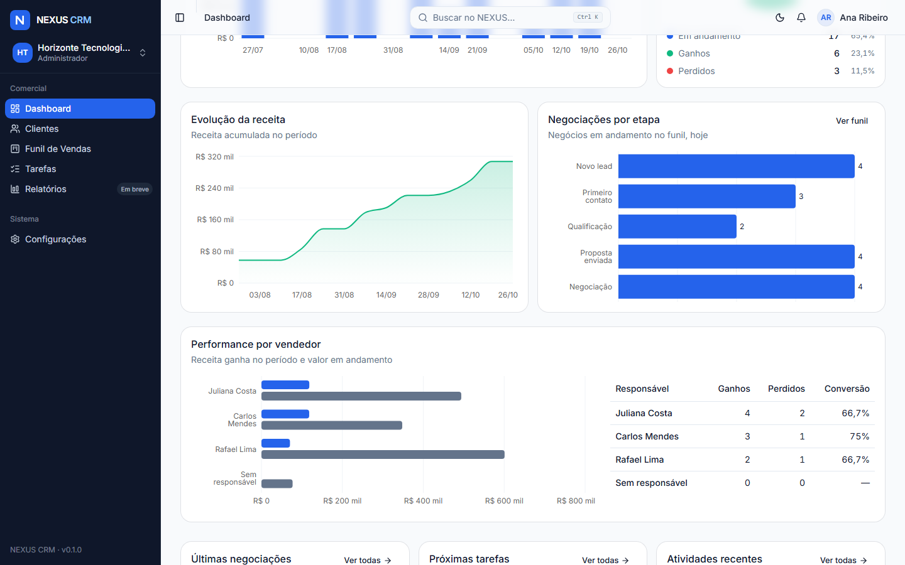</td>
    <td width="50%">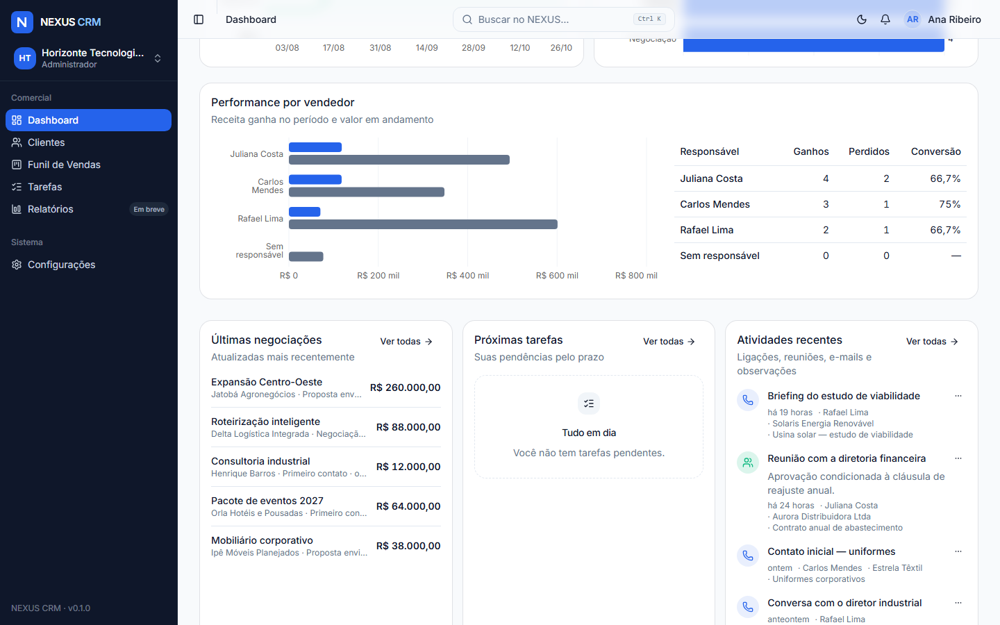</td>
  </tr>
  <tr>
    <td align="center"><sub>Receita acumulada, negócios por etapa e performance por vendedor</sub></td>
    <td align="center"><sub>Últimas negociações, próximas tarefas e atividades recentes</sub></td>
  </tr>
  <tr>
    <td width="50%">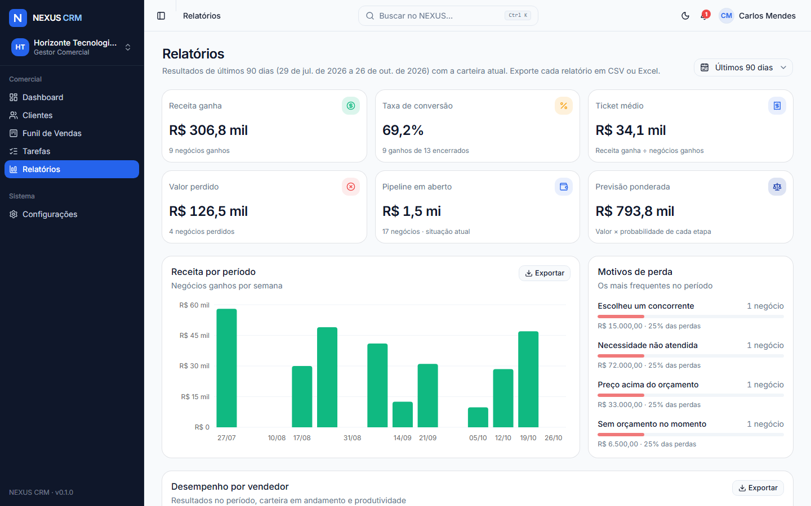</td>
    <td width="50%">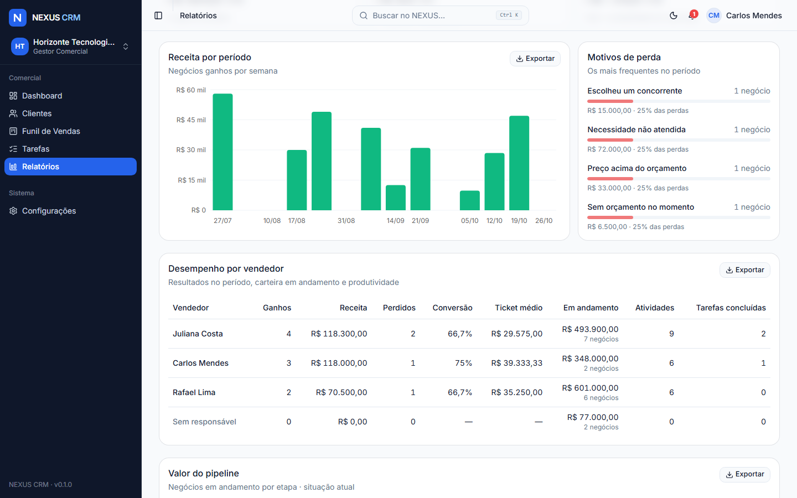</td>
  </tr>
  <tr>
    <td align="center"><sub>Relatórios: receita, conversão, ticket médio, previsão ponderada e motivos de perda</sub></td>
    <td align="center"><sub>Desempenho por vendedor e pipeline, com exportação em CSV e Excel</sub></td>
  </tr>
  <tr>
    <td width="50%"></td>
    <td width="50%">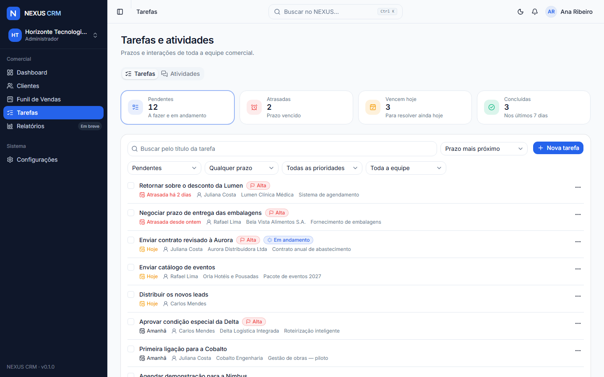</td>
  </tr>
  <tr>
    <td align="center"><sub>Funil de vendas em Kanban com arrastar e soltar</sub></td>
    <td align="center"><sub>Tarefas com prazo, prioridade, responsável e conclusão rápida</sub></td>
  </tr>
  <tr>
    <td width="50%">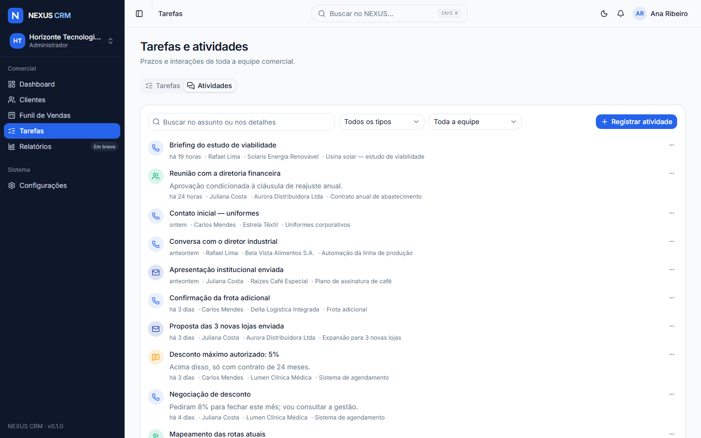</td>
    <td width="50%"></td>
  </tr>
  <tr>
    <td align="center"><sub>Histórico de ligações, reuniões, e-mails e observações</sub></td>
    <td align="center"><sub>Detalhe do negócio com abas de resumo, atividades e tarefas</sub></td>
  </tr>
  <tr>
    <td width="50%"></td>
    <td width="50%"></td>
  </tr>
  <tr>
    <td align="center"><sub>Detalhe do cliente: negócios, interações, tarefas e contatos</sub></td>
    <td align="center"><sub>Perdas exigem motivo; ganhos pedem confirmação</sub></td>
  </tr>
  <tr>
    <td width="50%"></td>
    <td width="50%"></td>
  </tr>
  <tr>
    <td align="center"><sub>Carteira de clientes com busca, filtros e paginação na URL</sub></td>
    <td align="center"><sub>Cadastro e edição em drawer, com validação de CPF/CNPJ</sub></td>
  </tr>
  <tr>
    <td width="50%"></td>
    <td width="50%">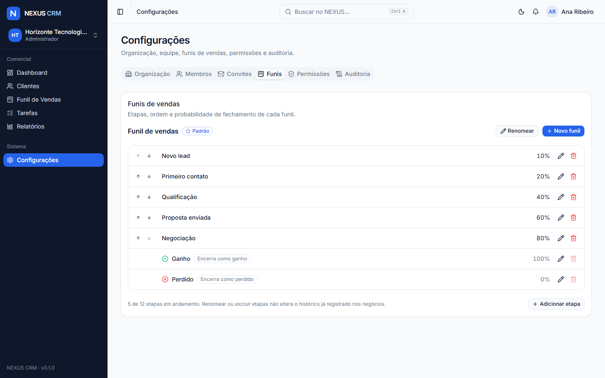</td>
  </tr>
  <tr>
    <td align="center"><sub>Membros: troca de perfil e suspensão de acesso</sub></td>
    <td align="center"><sub>Funis: etapas, ordem e probabilidade de fechamento</sub></td>
  </tr>
  <tr>
    <td width="50%">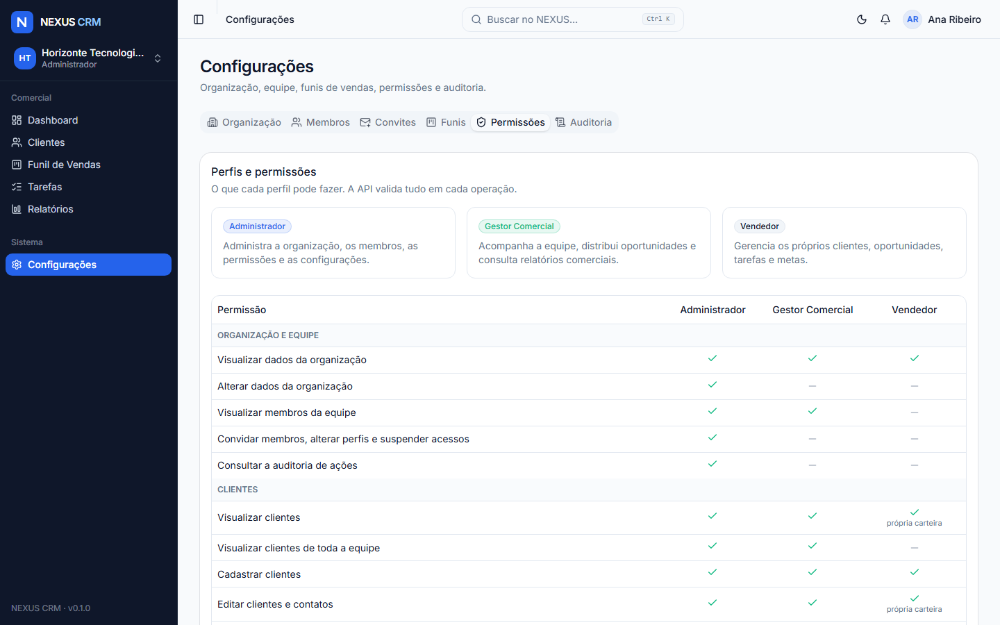</td>
    <td width="50%">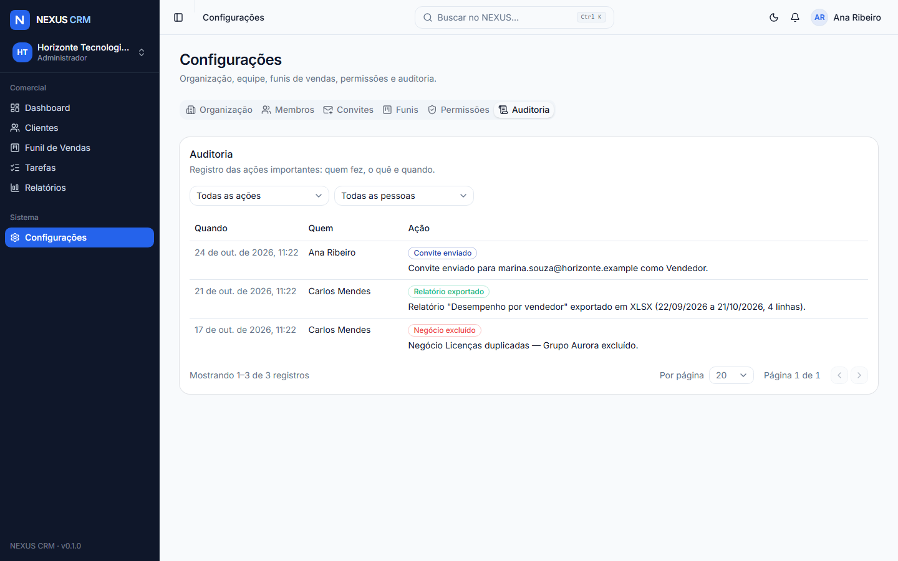</td>
  </tr>
  <tr>
    <td align="center"><sub>A mesma matriz de permissões usada pela API</sub></td>
    <td align="center"><sub>Auditoria das ações importantes: quem fez, o quê e quando</sub></td>
  </tr>
  <tr>
    <td width="50%">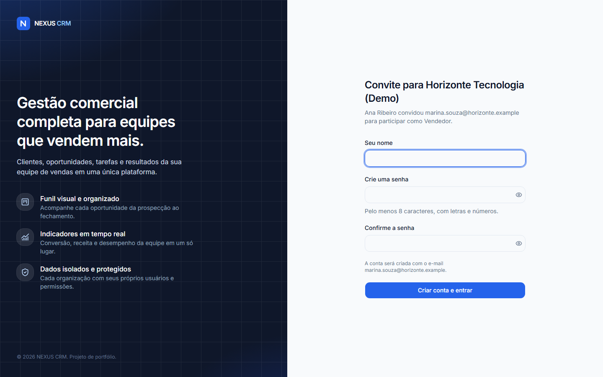</td>
    <td width="50%"></td>
  </tr>
  <tr>
    <td align="center"><sub>Convite por e-mail: a pessoa cria a conta e entra na organização</sub></td>
    <td align="center"><sub>Busca global de clientes, negócios e ações (<kbd>Ctrl</kbd> + <kbd>K</kbd>)</sub></td>
  </tr>
  <tr>
    <td width="50%"></td>
    <td width="50%"></td>
  </tr>
  <tr>
    <td align="center"><sub>Tema escuro</sub></td>
    <td align="center"><sub>Login com sessão segura em cookie HttpOnly</sub></td>
  </tr>
  <tr>
    <td width="50%"></td>
    <td width="50%" align="center"></td>
  </tr>
  <tr>
    <td align="center"><sub>Usuário com mais de uma organização escolhe onde trabalhar</sub></td>
    <td align="center"><sub>Layout responsivo</sub></td>
  </tr>
</table>

## ✨ Destaques técnicos

- **Autenticação de verdade, sem token no `localStorage`.** Sessão server-side em cookie
  `HttpOnly` (`SameSite=Lax`, `Secure` e prefixo `__Host-` em produção). O banco guarda só o hash
  SHA-256 do token, então logout, suspensão de acesso e troca de senha têm efeito imediato.
- **Proteção CSRF** no padrão _signed double-submit cookie_ (HMAC) em todas as requisições de
  escrita — inclusive login —, verificação de `Origin` e **rate limiting** nos endpoints sensíveis.
- **Isolamento multi-tenant por construção.** O `organizationId` nunca vem do cliente: as rotas
  operam sobre a organização ativa da sessão, e o vínculo do usuário é revalidado a cada requisição.
- **RBAC na API**, com a mesma matriz de permissões compartilhada com o frontend (que só a usa
  para esconder ações), e **controle por registro**: vendedores só enxergam a própria carteira; um
  cliente fora do escopo responde 404, sem revelar que existe.
- **Integridade multi-tenant também no banco.** Responsável, empresa vinculada e contatos usam
  **chaves estrangeiras compostas** com `organization_id`, e _CHECK constraints_ reforçam regras de
  negócio — mesmo um bug na API não consegue ligar registros de organizações diferentes.
- **Kanban com arrastar e soltar validado no servidor.** O quadro atualiza na hora (otimista) e
  desfaz o movimento se a API recusar; a API confere funil, etapa, permissão de reabertura e motivo
  da perda, grava o histórico e reposiciona o card com **índice fracionário** (um único `UPDATE`
  por movimento). Funciona também pelo teclado, com anúncios para leitores de tela em português.
- **Dashboard calculado no banco, no fuso certo.** Um único endpoint agrega indicadores, vendas
  por período, negócios por etapa, performance por vendedor e distribuição com `count`, `aggregate`
  e `groupBy`, usando os mesmos filtros de escopo das listagens — o vendedor vê a própria carteira,
  a gestão vê a equipe. Períodos e prazos seguem o fuso de Brasília, não o relógio do servidor.
- **Administração auditável.** Convites por e-mail com token de uso único (só o hash fica no
  banco), troca de perfil e suspensão com proteção do último administrador, e configuração de
  funis que move negócios com histórico ao excluir etapas. Cada ação importante entra na
  **auditoria na mesma transação**, e uma trigger torna a trilha somente de inclusão.
- **Relatórios exportáveis sem dependências.** CSV pronto para o Excel em português e XLSX gerado
  pela própria API (planilha tipada, com moeda, porcentagem e datas), com proteção contra _CSV
  injection_ e registro de cada exportação.
- **Domínio brasileiro levado a sério**: validação de CPF e de **CNPJ alfanumérico** (formato
  vigente desde julho de 2026), telefones e UFs, com formatação automática.
- **Senhas com Argon2id** (parâmetros OWASP) e resposta em tempo constante para e-mails
  inexistentes, evitando enumeração de usuários.
- **357 testes automatizados**, incluindo 112 de integração contra PostgreSQL real e 22
  testes ponta a ponta com Playwright — rodados também contra os contêineres de produção no CI.
- **Segurança verificada por testes.** Um teste lê todas as rotas da API e exige que cada uma
  declare sua proteção; outro varre todas as rotas por ID com a sessão de outra organização e
  confirma que nada vaza nem muda. Detalhes em [docs/security.md](docs/security.md).
- **Pronto para produção:** imagens Docker enxutas, Caddy com HTTPS automático e CSP sem scripts
  inline, migrations aplicadas antes da API subir e e-mails por SMTP —
  [docs/deploy.md](docs/deploy.md).
- **Nenhum dado fictício na interface.** Indicadores e relatórios vêm de agregações no banco; os
  dados de exemplo existem apenas na seed, identificada como demonstração.

## 🧰 Stack

| Camada         | Tecnologias                                                                                                                                              |
| -------------- | -------------------------------------------------------------------------------------------------------------------------------------------------------- |
| Frontend       | React 19, TypeScript 6, Vite 8, Tailwind CSS 4, shadcn/ui (Radix), React Router 8, TanStack Query 5, React Hook Form, Zod 4, dnd-kit, Recharts 3, Lucide |
| Backend        | Node.js 24, NestJS 11, Prisma 7 (driver adapter `pg`), PostgreSQL 17, Swagger/OpenAPI, class-validator, Argon2, Helmet, Throttler                        |
| Compartilhado  | `@nexus/shared`: perfis, matriz de permissões, schemas Zod e tipos da API                                                                                |
| Qualidade      | pnpm workspaces, ESLint 10, Prettier, Jest + Supertest (API), Vitest + Testing Library (web), Playwright (E2E), GitHub Actions                           |
| Infraestrutura | Docker e Docker Compose, Caddy (HTTPS automático), GitHub Container Registry, nodemailer (SMTP)                                                          |

As versões foram escolhidas após checagem de compatibilidade entre as bibliotecas — o motivo de
cada escolha está em [docs/decisions.md](docs/decisions.md).

## 🚀 Como executar

### Pré-requisitos

- **Node.js 24** (mínimo 22.12) — veja `.nvmrc`
- **pnpm 10** — `corepack enable` ou `npm install -g pnpm@10`
- **Docker** (recomendado) _ou_ um PostgreSQL 17 local

### Passo a passo

```bash
# 1. Dependências (gera também o Prisma Client)
pnpm install

# 2. Variáveis de ambiente
cp .env.example .env
cp apps/api/.env.example apps/api/.env
#    Em apps/api/.env, defina um CSRF_SECRET aleatório:
#    node -e "console.log(require('crypto').randomBytes(48).toString('base64url'))"

# 3. Banco de dados (PostgreSQL em Docker; cria também o banco de testes)
pnpm db:up

# 4. Migrations e dados de demonstração
pnpm db:deploy
pnpm db:seed

# 5. API (http://localhost:3333/api) + Web (http://localhost:5173)
pnpm dev
```

Acesse **http://localhost:5173** e entre com uma das [contas de demonstração](#contas-de-demonstração).
A documentação interativa da API (Swagger) fica em **http://localhost:3333/api/docs**.

<details>
<summary><strong>Sem Docker</strong></summary>

Instale o PostgreSQL 17, crie os bancos `nexus_crm` e `nexus_crm_test` e ajuste `DATABASE_URL` e
`DATABASE_URL_TEST` em `apps/api/.env`. Os demais passos são iguais (pule o `pnpm db:up`).

</details>

<details>
<summary><strong>E-mails em desenvolvimento</strong></summary>

Ainda não há provedor SMTP (previsto para uma fase futura). Em desenvolvimento, os e-mails — de
redefinição de senha e de convite — são gravados como arquivos `.eml` em `apps/api/.mail-outbox/`
(fora do Git). Abra o arquivo mais recente para copiar o link. O conteúdo nunca é escrito nos logs,
pois contém tokens.

</details>

### Contas de demonstração

Criadas por `pnpm db:seed` — **dados fictícios, para uso exclusivamente local** (domínio reservado
`.example`). A senha de todas as contas é o valor de `SEED_DEMO_PASSWORD` em `apps/api/.env`.

| E-mail                            | Perfil                                                                       |
| --------------------------------- | ---------------------------------------------------------------------------- |
| `ana.ribeiro@horizonte.example`   | Administrador — Horizonte Tecnologia (Demo)                                  |
| `carlos.mendes@horizonte.example` | Gestor (Horizonte) **e** Vendedor (Vértice) — escolhe a organização no login |
| `juliana.costa@horizonte.example` | Vendedor — Horizonte Tecnologia (Demo)                                       |
| `rafael.lima@horizonte.example`   | Vendedor — Horizonte Tecnologia (Demo)                                       |
| `beatriz.alves@vertice.example`   | Administrador — Vértice Consultoria (Demo)                                   |

A seed também cria **27 clientes fictícios** com contatos — 23 na Horizonte (distribuídos entre
Juliana, Rafael e Carlos, com 4 ainda sem responsável) e 4 na Vértice —, **49 negócios** (45 na
Horizonte, 20 deles encerrados ao longo do último ano para alimentar os gráficos, e 4 na Vértice),
**19 tarefas** com prazos relativos ao dia da execução (atrasadas, do dia e futuras), **25
atividades** registradas, um **convite pendente** e alguns registros de **auditoria**. Entre como
vendedor, gestor e administrador para comparar o que cada perfil vê.

Para testar o aceite de convite, entre como Ana, abra **Configurações → Convites**, use
**Reenviar** no convite pendente e abra o link do `.eml` mais recente (veja "E-mails em
desenvolvimento" acima).

A seed é idempotente — recria os dados comerciais das organizações de demonstração a cada execução
— e se recusa a rodar com `NODE_ENV=production` (exceto com `DEMO_MODE=true`, para um ambiente
público isolado de demonstração).

## 🧩 Funcionalidades

### Fase 5 — Administração e relatórios

- **Configurações em abas**: organização, membros, convites, funis, permissões e auditoria — cada
  perfil vê apenas as abas que pode usar.
- **Gestão de membros**: o administrador troca o perfil e suspende ou reativa acessos (com efeito
  imediato). Ninguém altera o próprio vínculo e a organização nunca fica sem administrador ativo.
- **Convites por e-mail** com perfil definido, validade de 7 dias, reenvio e cancelamento. Quem não
  tem conta cria nome e senha pelo link e já entra; quem tem conta ganha o acesso à organização.
- **Permissões**: matriz por perfil — a mesma usada pela API — com o escopo de carteira do vendedor.
- **Configuração de funis**: novos funis, funil padrão, etapas com probabilidade, reordenação e
  exclusão com destino obrigatório para os negócios da etapa (registrado no histórico). O cadastro
  de negócios agrupa as etapas por funil.
- **Relatórios** (gestão e administração) com filtro de período: receita ganha, taxa de conversão,
  ticket médio, valor perdido, pipeline em aberto e **previsão ponderada**; receita por período,
  motivos de perda, desempenho por vendedor (com atividades e tarefas concluídas), valor do pipeline
  por etapa e negócios ganhos e perdidos com filtro e paginação.
- **Exportação** de cada relatório em **CSV** e **Excel (.xlsx)**.
- **Auditoria** de alterações de membros e perfis, convites, funis e etapas, exclusões de clientes e
  negócios, reaberturas e exportações, com filtros por tipo de ação e pessoa.

### Fase 4 — Dashboard, tarefas e atividades

- **Dashboard comercial** com filtro de período (7, 30 e 90 dias, 12 meses e ano corrente):
  total de clientes, oportunidades abertas, valor do pipeline, negociações ganhas e perdidas,
  receita, taxa de conversão e tarefas pendentes.
- **Gráficos interativos**: vendas por período (dia, semana ou mês, conforme o intervalo),
  evolução da receita acumulada, negociações por etapa, performance por vendedor (com conversão
  individual) e distribuição dos negócios criados no período.
- **Últimas negociações, próximas tarefas e atividades recentes** no próprio painel.
- **Tarefas** com responsável, prazo, prioridade e status (a fazer, em andamento, concluída,
  cancelada), ligadas a clientes e negócios; conclusão com um clique, filtros de prazo (atrasadas,
  hoje, próximos 7 dias), prioridade e responsável, e totais clicáveis.
- **Registro de interações**: ligações, reuniões, e-mails e observações com data e hora, ligados
  a um cliente e, opcionalmente, a um negócio. Só o autor edita o próprio registro.
- **Histórico de interações e tarefas** no detalhe do cliente e em abas no detalhe do negócio,
  com cadastro já vinculado.
- **Notificações** no sino da topbar com as tarefas atrasadas e do dia; atalhos "Nova tarefa" e
  "Registrar atividade" na busca global.

### Fase 3 — Negociações e funil de vendas

- **Funil padrão** criado com cada organização: Novo lead, Primeiro contato, Qualificação,
  Proposta enviada, Negociação, Ganho e Perdido, cada etapa com probabilidade de fechamento.
- **Negócios** com nome, cliente, valor potencial (em reais), previsão de fechamento, responsável,
  etapa e observações; cadastro e edição em drawer, com o valor formatado ao sair do campo.
- **Kanban com arrastar e soltar** entre etapas e dentro delas, com totais e contagem por coluna,
  tempo na etapa, previsão vencida em destaque e menu "Mover para…" como alternativa ao arraste.
- **Ganho e perda**: ganhar pede confirmação; perder exige motivo (com sugestões frequentes).
  Negócios encerrados ficam bloqueados para edição; só gestores e administradores os reabrem.
- **Histórico de movimentações** de cada negócio: etapas, status, motivo da perda, autor e data.
- **Carteira**: vendedores veem e movimentam só os próprios negócios; gestores filtram o quadro por
  responsável e distribuem negócios.
- **Indicadores**: valor em andamento, ganhos, receita, perdidos e taxa de conversão no funil e no
  Dashboard, calculados no banco dentro do escopo de cada perfil.
- **Integração com clientes**: a página do cliente lista seus negócios e permite criar um já
  vinculado; clientes com negócios não podem ser excluídos.
- **Busca global** encontra negócios e oferece o atalho "Novo negócio"; links como
  `/funil?negocio=<id>` abrem o negócio direto no drawer.

### Fase 2 — Clientes e contatos

- **Empresas e pessoas físicas**, com CPF/CNPJ validados (inclusive CNPJ alfanumérico), contato,
  site, cidade/UF, status (lead, ativo, inativo), tags e observações.
- **Empresa vinculada**: pessoas físicas podem ser ligadas a um cliente empresa, que lista as
  pessoas vinculadas.
- **Contatos** por cliente, com contato principal único garantido pela API.
- **Responsável comercial**: o vendedor cadastra para si; gestores e administradores distribuem e
  redistribuem clientes, inclusive os ainda sem responsável.
- **Listagem** com busca (nome, e-mail, telefone ou CPF/CNPJ), filtros por status, tipo,
  responsável e tag, ordenação e paginação — tudo refletido na URL, com links compartilháveis.
- **Indicadores da carteira** (total, leads, ativos, sem responsável) que também funcionam como
  filtros; o total de clientes alimenta o Dashboard.
- **Detalhe do cliente** com dados, contatos, pessoas vinculadas e histórico de cadastro.
- **Busca global** (<kbd>Ctrl</kbd> + <kbd>K</kbd>) encontra clientes e oferece o atalho "Novo
  cliente".
- **Exclusão** (gestores e administradores) com confirmação; contatos são removidos e pessoas
  vinculadas são preservadas.

### Fase 1 — Fundação

- **Cadastro inicial** de organização + administrador (em uma única transação).
- **Login, logout e sessão** com expiração e revogação.
- **Recuperação e redefinição de senha** com token de uso único; a redefinição encerra todas as
  sessões abertas.
- **Múltiplas organizações por usuário**, com tela de seleção e troca de organização ativa.
- **Perfis de acesso**: Administrador, Gestor Comercial e Vendedor.
- **Layout definitivo**: sidebar recolhível, topbar com busca (<kbd>Ctrl</kbd> + <kbd>K</kbd>),
  notificações, menu do usuário, tema claro/escuro, layout responsivo, skeletons, toasts e estados
  vazios.
- **Dashboard inicial** com dados reais do PostgreSQL (substituído pelo painel comercial na Fase 4).
- **Configurações**: nome da organização (somente administradores), membros (administradores e
  gestores) e descrição dos perfis.
- Módulos futuros exibiam o escopo planejado, sem simular operações (os relatórios chegaram na
  Fase 5).
- **Swagger** em `/api/docs` e **health check** em `/api/health`.

## 🏗 Arquitetura

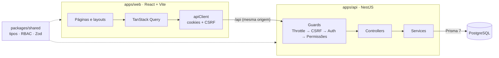

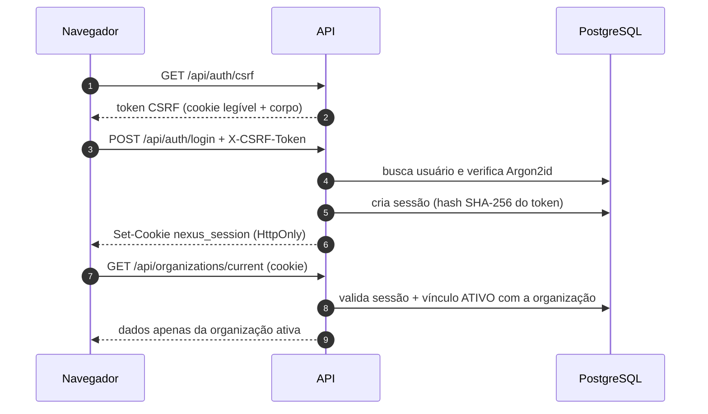

- **Monorepositório** com pnpm workspaces: `apps/web`, `apps/api` e `packages/shared`.
- **API modular** (`auth`, `organizations`, `invitations`, `customers`, `deals`, `tasks`,
  `activities`, `dashboard`, `reports`, `audit`, `mail`, `health`), com regras de negócio nos
  services e controllers finos. Todo
  acesso a clientes, negócios, tarefas e atividades passa por um filtro de escopo (organização
  ativa + carteira do usuário).
- **Frontend** separado em `services` (acesso à API), `features` (hooks e componentes por domínio),
  `pages`, `layouts` e `routes`.

Detalhes em [docs/architecture.md](docs/architecture.md) e decisões em
[docs/decisions.md](docs/decisions.md).

<details>
<summary><strong>Estrutura de pastas</strong></summary>

```
nexus-crm/
├── apps/
│   ├── api/                      # NestJS
│   │   ├── prisma/               # schema, migrations e seed de demonstração
│   │   ├── src/
│   │   │   ├── common/           # guards, decorators, filtros, segurança, utilitários
│   │   │   ├── config/           # validação e acesso tipado ao ambiente
│   │   │   ├── modules/          # auth, organizations, customers, deals, tasks, activities…
│   │   │   └── prisma/           # PrismaService
│   │   └── test/                 # testes de integração
│   └── web/                      # React + Vite
│       └── src/
│           ├── app/              # providers e tema
│           ├── components/       # componentes compartilhados e ui/ (shadcn)
│           ├── features/         # auth, customers, deals, tasks, activities, dashboard…
│           ├── layouts/          # AuthLayout, AppLayout (sidebar, topbar)
│           ├── lib/              # query client, navegação, formatação
│           ├── pages/            # páginas por rota
│           ├── routes/           # router e guards de rota
│           ├── services/         # camada de acesso à API
│           └── types/
├── packages/shared/              # tipos, RBAC e schemas compartilhados
├── e2e/                          # testes ponta a ponta (Playwright)
├── docker/                       # inicialização do Postgres e configuração do Caddy
├── docs/                         # arquitetura, decisões, segurança, deploy e capturas de tela
├── docker-compose.yml            # PostgreSQL de desenvolvimento
└── docker-compose.prod.yml       # produção: Caddy, API, migrations e PostgreSQL
```

</details>

## 🧪 Testes

| Suíte                   | Ferramentas                   | Testes | Cobertura principal                                                         |
| ----------------------- | ----------------------------- | -----: | --------------------------------------------------------------------------- |
| `packages/shared`       | Vitest                        |     74 | RBAC, schemas, CPF/CNPJ, valores, datas, períodos, convites e funis         |
| `apps/api` (unitários)  | Jest                          |     56 | Guards, proteção de todas as rotas, configuração, e-mail, exportação        |
| `apps/api` (integração) | Jest + Supertest + PostgreSQL |    112 | Critérios de aceite das Fases 1 a 6 e varredura de isolamento (abaixo)      |
| `apps/web`              | Vitest + Testing Library      |     93 | Rotas, formulários, quadro, indicadores, convites, abas, erros e exportação |
| `e2e`                   | Playwright                    |     22 | Fluxos completos no navegador, por perfil, contra o build e contra o Docker |

Critérios de aceite verificados pelos testes de integração:

- ✅ Um usuário consegue se cadastrar e entrar; os dados são persistidos no PostgreSQL.
- ✅ Usuário não autenticado não acessa rotas protegidas (401).
- ✅ Vendedor não acessa endpoints administrativos (403) e nada é alterado no banco.
- ✅ Usuários de organizações distintas não consultam nem alteram dados uns dos outros.
- ✅ O logout revoga a sessão: o mesmo cookie deixa de funcionar.
- ✅ Vínculo suspenso perde o acesso imediatamente; CSRF, rate limit e redefinição de senha.
- ✅ Vendedor vê e altera apenas a própria carteira; clientes de outros respondem 404.
- ✅ Só a gestão distribui clientes, e apenas para membros ativos da mesma organização.
- ✅ Empresa vinculada, responsável e contatos não podem apontar para outra organização.
- ✅ Busca, filtros, paginação, tags e totais respeitam o escopo de cada perfil.
- ✅ Toda organização nasce com o funil padrão; negócios só usam clientes visíveis ao usuário.
- ✅ Movimentações gravam histórico; perda sem motivo e etapa de outro funil são recusadas.
- ✅ Só gestores e administradores reabrem ou movem negócios encerrados, que não podem ser editados.
- ✅ A ordem dos cards é preservada; o quadro de uma organização nunca mostra negócios de outra.
- ✅ Cliente com negócios não pode ser excluído.
- ✅ Vendedor cria tarefas só para si; a gestão atribui apenas a membros ativos da organização.
- ✅ Tarefas e atividades só se ligam a clientes e negócios visíveis; o negócio define o cliente.
- ✅ Atrasadas, do dia e da semana seguem o fuso de negócio; concluir e reabrir mantêm as datas coerentes.
- ✅ Só o autor edita uma atividade; a gestão modera exclusões; datas futuras são recusadas.
- ✅ Excluir um negócio preserva tarefas e atividades no cliente; excluir o cliente as remove.
- ✅ O dashboard respeita o escopo de cada perfil, o período informado e o isolamento entre organizações.
- ✅ Só o administrador gerencia membros, convites e funis; ninguém altera o próprio vínculo.
- ✅ O convite cria a conta (ou só o vínculo, se ela existir); links reenviados, cancelados, vencidos ou usados não abrem.
- ✅ Excluir uma etapa move seus negócios com histórico; ganho e perda ficam sempre ao final.
- ✅ A auditoria registra as ações importantes, é visível só ao administrador e o banco recusa alterações.
- ✅ Relatórios e exportações (CSV e Excel) ficam restritos à gestão e consolidam apenas a organização ativa.
- ✅ Nenhuma das 28 rotas por ID alcança registros de outra organização, e referências cruzadas em corpos de requisição são recusadas.
- ✅ Falhas no envio de e-mail não revelam quais contas existem; convites avisam o administrador para reenviar.

Fluxos verificados pelos testes E2E (Playwright):

- ✅ Login com retorno à página pedida, erro de senha, logout que invalida o cookie e cadastro de organização.
- ✅ Escolha de organização por quem participa de mais de uma.
- ✅ Cadastro e busca de clientes; negócio criado, movido pelo menu e **pelo teclado** (com anúncios
  para leitores de tela) e encerrado como perdido, com histórico.
- ✅ Tarefas concluídas e interações registradas pela vendedora.
- ✅ Permissões por perfil e isolamento entre organizações vistos pelo navegador e pela API.
- ✅ Convite por e-mail aceito por uma pessoa nova, troca de perfil e etapas do funil com confirmação.
- ✅ Relatórios por período e downloads reais em CSV e Excel.
- ✅ Busca global pelo teclado, tema escuro persistente, layout no celular e página não encontrada.

```bash
pnpm test               # unitários (shared, API e web)
pnpm test:integration   # integração da API contra PostgreSQL (usa DATABASE_URL_TEST)
pnpm build && pnpm test:e2e   # ponta a ponta: sobe API e frontend compilados e recria a seed
```

Os testes de integração usam um banco separado (`nexus_crm_test`), limpo antes de cada teste; os
testes E2E usam o mesmo banco, recriado pela seed de demonstração no início da execução. Na
primeira vez, instale o navegador com `pnpm --filter @nexus/e2e exec playwright install chromium`
(ou use um navegador instalado com `E2E_BROWSER_CHANNEL=msedge` ou `chrome`).

O [pipeline de CI](.github/workflows/ci.yml) tem três jobs: (1) lint, formatação, typecheck,
testes unitários, integração e build; (2) testes E2E contra o build; (3) build das imagens Docker,
ambiente de produção com Caddy, verificação dos cabeçalhos de segurança e os testes E2E contra os
contêineres.

## 🚢 Deploy

Qualquer servidor com Docker hospeda o NEXUS CRM com HTTPS automático:

```bash
cp .env.production.example .env.production   # domínio, senhas, segredo CSRF e SMTP
docker compose -f docker-compose.prod.yml --env-file .env.production up -d --build
```

O Caddy serve o frontend e repassa `/api` para a API (mesma origem), as migrations rodam antes de
a API subir e só o Caddy publica portas. Um perfil `demo` opcional cria os dados fictícios para uma
demonstração pública isolada. Tags `v*.*.*` publicam as imagens no GitHub Container Registry.
Passo a passo, variáveis, backup e checklist em [docs/deploy.md](docs/deploy.md).

## 📜 Scripts

Executados na raiz do repositório:

| Comando                        | Descrição                                                           |
| ------------------------------ | ------------------------------------------------------------------- |
| `pnpm dev`                     | Sobe pacote compartilhado (watch), API e Web                        |
| `pnpm build`                   | Build de produção de todos os pacotes                               |
| `pnpm typecheck`               | Verificação de tipos em todo o monorepositório                      |
| `pnpm lint` / `lint:fix`       | ESLint                                                              |
| `pnpm format` / `format:check` | Prettier                                                            |
| `pnpm test`                    | Testes unitários (shared, API e web)                                |
| `pnpm test:integration`        | Testes de integração da API contra PostgreSQL (`DATABASE_URL_TEST`) |
| `pnpm test:e2e`                | Testes ponta a ponta com Playwright (requer `pnpm build`)           |
| `pnpm db:up` / `db:down`       | Sobe/derruba o PostgreSQL no Docker                                 |
| `pnpm db:migrate`              | Cria/aplica migrations em desenvolvimento (`prisma migrate dev`)    |
| `pnpm db:deploy`               | Aplica migrations existentes (`prisma migrate deploy`)              |
| `pnpm db:seed`                 | Popula os dados de demonstração                                     |
| `pnpm db:reset`                | Recria o banco de desenvolvimento do zero                           |

## 🔐 Segurança

- Senhas com **Argon2id** e verificação em tempo constante para e-mails inexistentes.
- **Sessão server-side**: o cookie carrega só um token aleatório de 256 bits; o banco guarda apenas
  o hash SHA-256.
- **CSRF** (_signed double-submit cookie_) em todas as requisições de escrita, mais verificação de
  `Origin`.
- **Rate limiting** geral e restrito nos endpoints de autenticação.
- **Multi-tenant**: rotas operam sobre a organização ativa da sessão; organizações inexistentes e
  alheias recebem a mesma resposta, sem revelar quais existem.
- Validação estrita de DTOs (`whitelist` + `forbidNonWhitelisted`), Helmet, CORS restrito,
  `Cache-Control: no-store`, erros padronizados sem detalhes internos e logs sem corpo, cookies ou
  tokens.
- **Convites** com token de 256 bits de uso único (o banco guarda só o hash) e rate limit nas
  rotas públicas de pré-visualização e aceite.
- **Auditoria** gravada na transação de cada ação, sem senhas ou tokens, e somente de inclusão
  (trigger no PostgreSQL). Exportações são auditadas e protegidas contra _CSV injection_.
- **Em produção**, o Caddy aplica CSP sem scripts inline, HSTS, `X-Frame-Options: DENY`,
  `nosniff` e `Referrer-Policy: no-referrer`; o Swagger fica desligado por padrão.
- **Dependências** sem vulnerabilidades conhecidas no `pnpm audit` (correções aplicadas via
  `overrides`).
- Segredos apenas em variáveis de ambiente, validadas na inicialização. Arquivos `.env` nunca são
  versionados — cada um tem um `.env.example` documentado.

A revisão completa, com os achados desta fase e os riscos residuais, está em
[docs/security.md](docs/security.md).

| Arquivo           | Uso                                                         |
| ----------------- | ----------------------------------------------------------- |
| `.env`            | Docker Compose (usuário, senha, banco e porta do Postgres)  |
| `apps/api/.env`   | API: banco, segredo CSRF, sessão, rate limit, Swagger, seed |
| `apps/web/.env`   | Opcional: destino do proxy e URL da API                     |
| `.env.production` | Produção com Docker: domínio, banco, segredo CSRF, SMTP     |

## 🗺 Roadmap

| Fase | Escopo                                                                 | Status       |
| ---- | ---------------------------------------------------------------------- | ------------ |
| 1    | Fundação: monorepo, auth, organizações, RBAC, layout, seed, testes, CI | ✅ Concluída |
| 2    | Clientes e contatos: CRUD, busca, filtros, paginação, permissões       | ✅ Concluída |
| 3    | Negociações: pipeline, etapas, Kanban com drag-and-drop, histórico     | ✅ Concluída |
| 4    | Dashboard com indicadores reais, tarefas e atividades                  | ✅ Concluída |
| 5    | Administração (convites, permissões, pipelines), relatórios, auditoria | ✅ Concluída |
| 6    | Testes E2E (Playwright), revisão de segurança, CI/CD, deploy e docs    | ✅ Concluída |

Próximos passos possíveis, fora do escopo das seis fases: autenticação em dois fatores, metas
comerciais, notificações em tempo real e exportações em segundo plano com filas.

## 👤 Autor

Desenvolvido por [**UyankDouglas**](https://github.com/UyankDouglas) como projeto de portfólio.

Todos os dados de demonstração são fictícios. Este repositório ainda não define uma licença de uso.
