<div align="center">


# NEXUS CRM

**SaaS de gestão comercial multi-tenant para pequenas e médias empresas.**<br />
Clientes, oportunidades, funil de vendas, tarefas, equipe e resultados em uma única plataforma.

[](https://github.com/UyankDouglas/nexus-crm/actions/workflows/ci.yml)


[Telas](#-telas) · [Destaques técnicos](#-destaques-técnicos) · [Como executar](#-como-executar) ·
[Arquitetura](#-arquitetura) · [Testes](#-testes) · [Roadmap](#-roadmap)

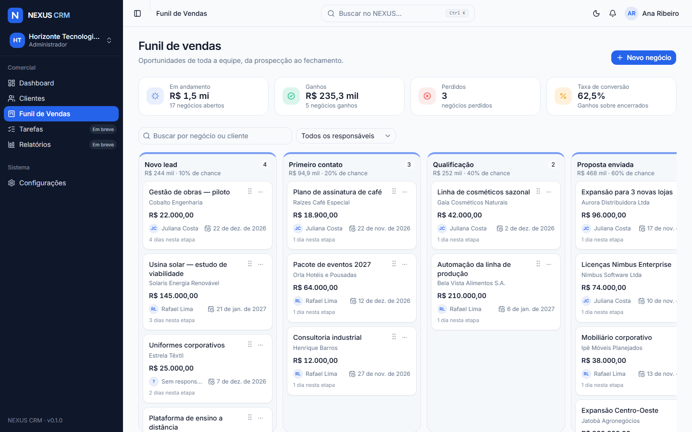

</div>

---

## Sobre o projeto

O NEXUS CRM é um projeto de portfólio **Full Stack** construído como um produto real: frontend,
API, banco de dados, autenticação segura, controle de acesso por perfil, isolamento entre
organizações e testes automatizados — desenvolvido de forma incremental, em seis fases, mantendo o
sistema executável ao fim de cada uma.

Cada organização tem seus próprios usuários, dados e permissões. Um mesmo usuário pode participar
de várias organizações, com um perfil diferente em cada uma.

> **Status:** Fase 1 — Fundação ✅ · Fase 2 — Clientes e contatos ✅ · Fase 3 — Negociações e
> funil de vendas ✅ · Próxima: Fase 4 — Dashboard, tarefas e atividades.

## 📸 Telas

<table>
  <tr>
    <td width="50%">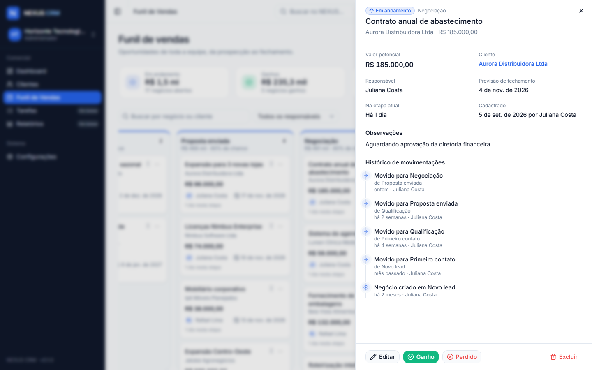</td>
    <td width="50%">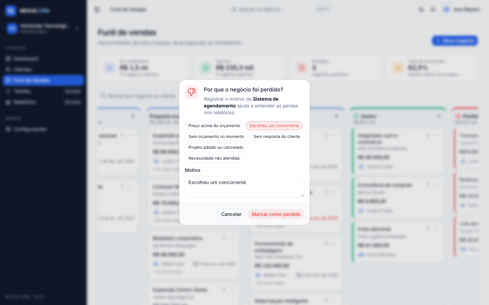</td>
  </tr>
  <tr>
    <td align="center"><sub>Detalhe do negócio: valor, previsão, responsável e histórico de etapas</sub></td>
    <td align="center"><sub>Perdas exigem motivo; ganhos pedem confirmação</sub></td>
  </tr>
  <tr>
    <td width="50%">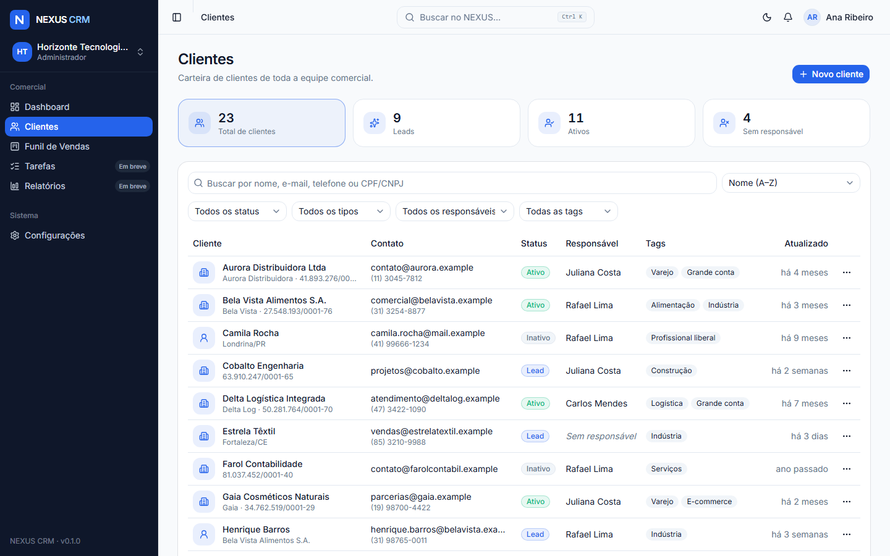</td>
    <td width="50%">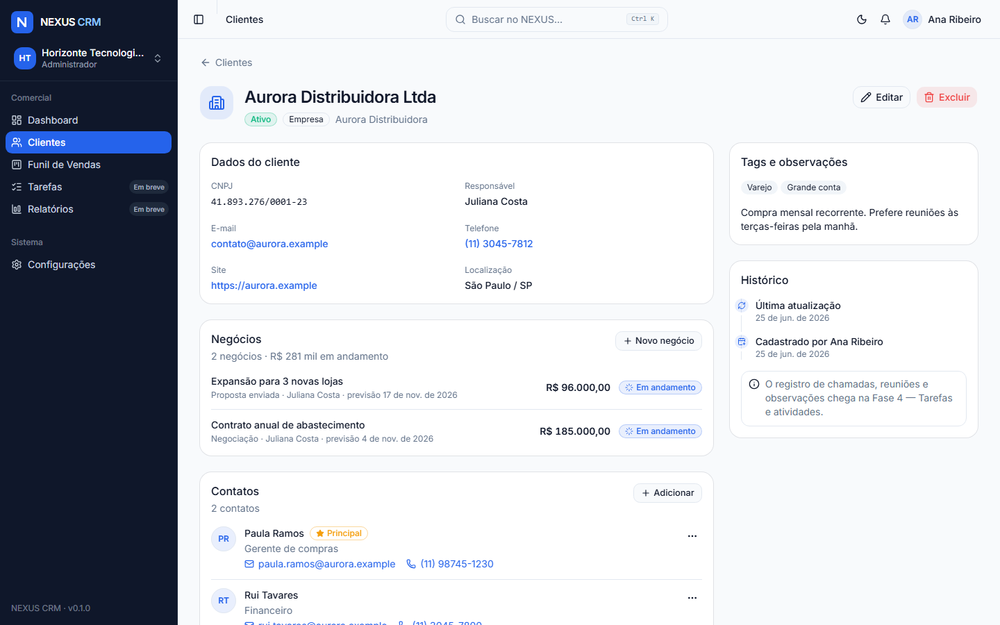</td>
  </tr>
  <tr>
    <td align="center"><sub>Carteira de clientes com busca, filtros e paginação na URL</sub></td>
    <td align="center"><sub>Detalhe do cliente: negócios, contatos, pessoas vinculadas e histórico</sub></td>
  </tr>
  <tr>
    <td width="50%">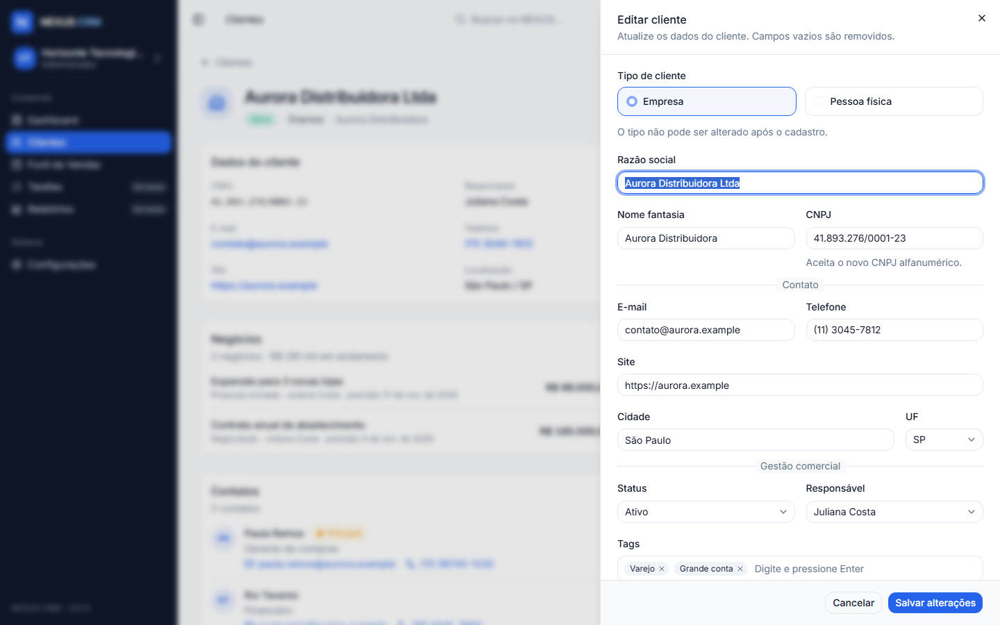</td>
    <td width="50%">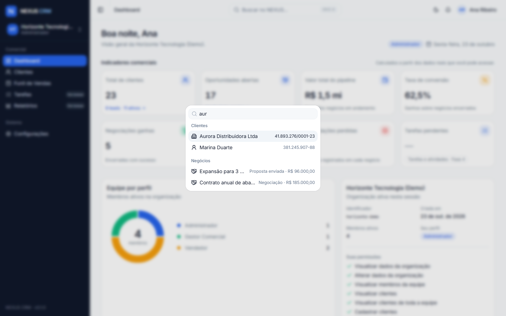</td>
  </tr>
  <tr>
    <td align="center"><sub>Cadastro e edição em drawer, com validação de CPF/CNPJ</sub></td>
    <td align="center"><sub>Busca global de clientes, negócios e módulos (<kbd>Ctrl</kbd> + <kbd>K</kbd>)</sub></td>
  </tr>
  <tr>
    <td width="50%">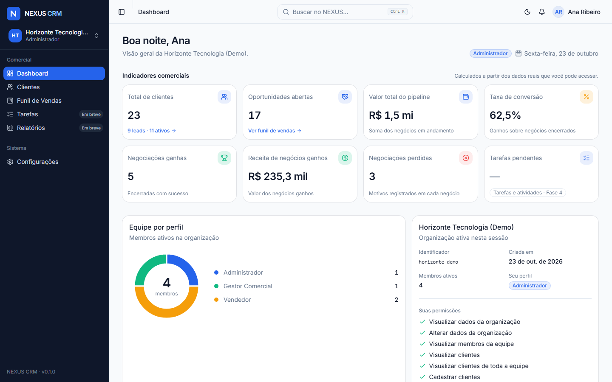</td>
    <td width="50%">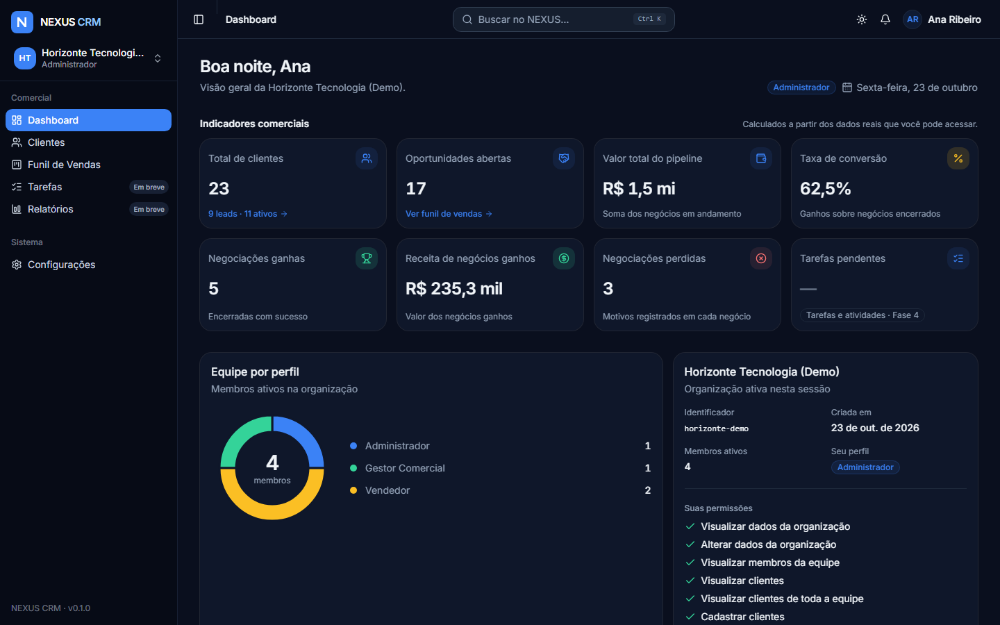</td>
  </tr>
  <tr>
    <td align="center"><sub>Dashboard com indicadores comerciais calculados no banco</sub></td>
    <td align="center"><sub>Tema escuro</sub></td>
  </tr>
  <tr>
    <td width="50%">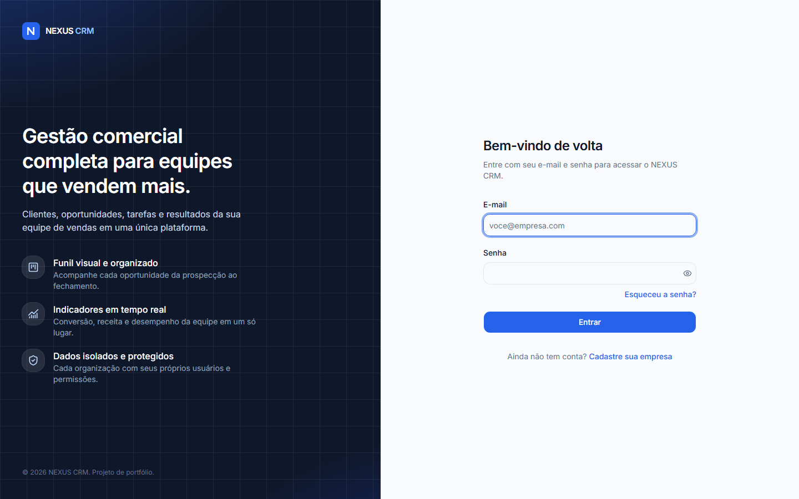</td>
    <td width="50%">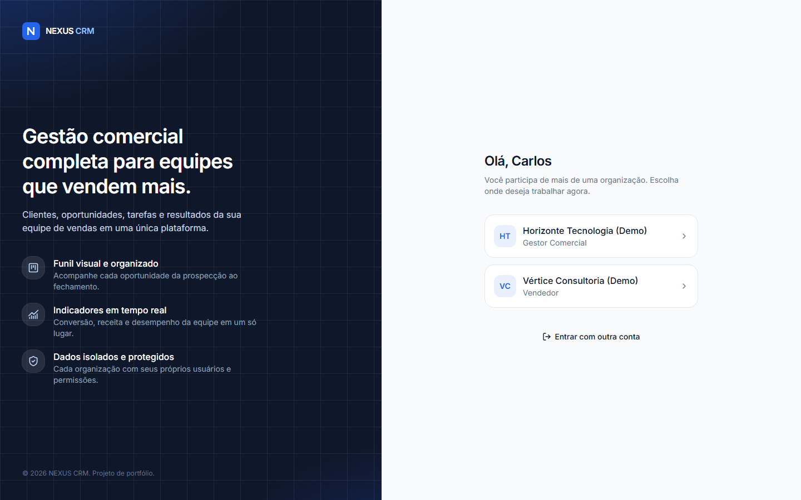</td>
  </tr>
  <tr>
    <td align="center"><sub>Login com sessão segura em cookie HttpOnly</sub></td>
    <td align="center"><sub>Usuário com mais de uma organização escolhe onde trabalhar</sub></td>
  </tr>
  <tr>
    <td width="50%">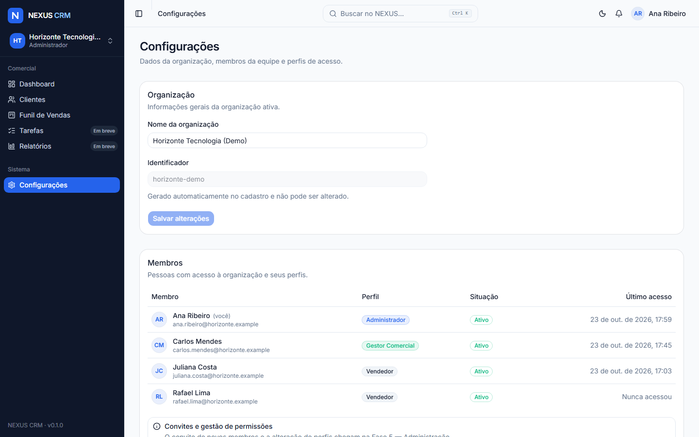</td>
    <td width="50%" align="center">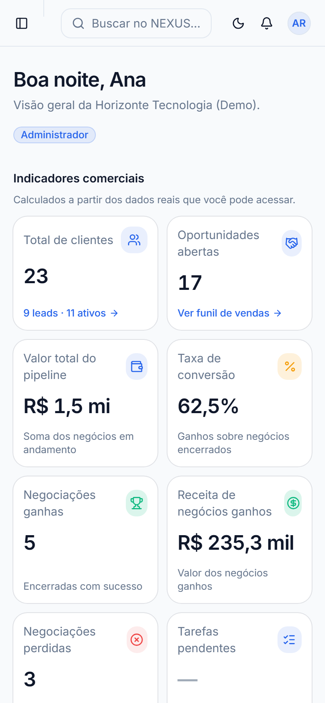</td>
  </tr>
  <tr>
    <td align="center"><sub>Configurações: organização, membros e perfis de acesso</sub></td>
    <td align="center"><sub>Layout responsivo</sub></td>
  </tr>
</table>

## ✨ Destaques técnicos

- **Autenticação de verdade, sem token no `localStorage`.** Sessão server-side em cookie
  `HttpOnly` (`SameSite=Lax`, `Secure` e prefixo `__Host-` em produção). O banco guarda só o hash
  SHA-256 do token, então logout, suspensão de acesso e troca de senha têm efeito imediato.
- **Proteção CSRF** no padrão _signed double-submit cookie_ (HMAC) em todas as requisições de
  escrita — inclusive login —, verificação de `Origin` e **rate limiting** nos endpoints sensíveis.
- **Isolamento multi-tenant por construção.** O `organizationId` nunca vem do cliente: as rotas
  operam sobre a organização ativa da sessão, e o vínculo do usuário é revalidado a cada requisição.
- **RBAC na API**, com a mesma matriz de permissões compartilhada com o frontend (que só a usa
  para esconder ações), e **controle por registro**: vendedores só enxergam a própria carteira; um
  cliente fora do escopo responde 404, sem revelar que existe.
- **Integridade multi-tenant também no banco.** Responsável, empresa vinculada e contatos usam
  **chaves estrangeiras compostas** com `organization_id`, e _CHECK constraints_ reforçam regras de
  negócio — mesmo um bug na API não consegue ligar registros de organizações diferentes.
- **Kanban com arrastar e soltar validado no servidor.** O quadro atualiza na hora (otimista) e
  desfaz o movimento se a API recusar; a API confere funil, etapa, permissão de reabertura e motivo
  da perda, grava o histórico e reposiciona o card com **índice fracionário** (um único `UPDATE`
  por movimento). Funciona também pelo teclado, com anúncios para leitores de tela em português.
- **Domínio brasileiro levado a sério**: validação de CPF e de **CNPJ alfanumérico** (formato
  vigente desde julho de 2026), telefones e UFs, com formatação automática.
- **Senhas com Argon2id** (parâmetros OWASP) e resposta em tempo constante para e-mails
  inexistentes, evitando enumeração de usuários.
- **212 testes automatizados**, incluindo 66 testes de integração contra PostgreSQL real que
  verificam os critérios de aceite de segurança e de negócio — e um pipeline de CI que roda tudo a
  cada push.
- **Nenhum dado fictício na interface.** Indicadores vêm de agregações no banco; os que dependem de
  módulos futuros mostram de onde virão os dados, em vez de números inventados.

## 🧰 Stack

| Camada         | Tecnologias                                                                                                                                              |
| -------------- | -------------------------------------------------------------------------------------------------------------------------------------------------------- |
| Frontend       | React 19, TypeScript 6, Vite 8, Tailwind CSS 4, shadcn/ui (Radix), React Router 8, TanStack Query 5, React Hook Form, Zod 4, dnd-kit, Recharts 3, Lucide |
| Backend        | Node.js 24, NestJS 11, Prisma 7 (driver adapter `pg`), PostgreSQL 17, Swagger/OpenAPI, class-validator, Argon2, Helmet, Throttler                        |
| Compartilhado  | `@nexus/shared`: perfis, matriz de permissões, schemas Zod e tipos da API                                                                                |
| Qualidade      | pnpm workspaces, ESLint 10, Prettier, Jest + Supertest (API), Vitest + Testing Library (web), GitHub Actions                                             |
| Infraestrutura | Docker Compose (PostgreSQL)                                                                                                                              |

As versões foram escolhidas após checagem de compatibilidade entre as bibliotecas — o motivo de
cada escolha está em [docs/decisions.md](docs/decisions.md).

## 🚀 Como executar

### Pré-requisitos

- **Node.js 24** (mínimo 22.12) — veja `.nvmrc`
- **pnpm 10** — `corepack enable` ou `npm install -g pnpm@10`
- **Docker** (recomendado) _ou_ um PostgreSQL 17 local

### Passo a passo

```bash
# 1. Dependências (gera também o Prisma Client)
pnpm install

# 2. Variáveis de ambiente
cp .env.example .env
cp apps/api/.env.example apps/api/.env
#    Em apps/api/.env, defina um CSRF_SECRET aleatório:
#    node -e "console.log(require('crypto').randomBytes(48).toString('base64url'))"

# 3. Banco de dados (PostgreSQL em Docker; cria também o banco de testes)
pnpm db:up

# 4. Migrations e dados de demonstração
pnpm db:deploy
pnpm db:seed

# 5. API (http://localhost:3333/api) + Web (http://localhost:5173)
pnpm dev
```

Acesse **http://localhost:5173** e entre com uma das [contas de demonstração](#contas-de-demonstração).
A documentação interativa da API (Swagger) fica em **http://localhost:3333/api/docs**.

<details>
<summary><strong>Sem Docker</strong></summary>

Instale o PostgreSQL 17, crie os bancos `nexus_crm` e `nexus_crm_test` e ajuste `DATABASE_URL` e
`DATABASE_URL_TEST` em `apps/api/.env`. Os demais passos são iguais (pule o `pnpm db:up`).

</details>

<details>
<summary><strong>E-mails em desenvolvimento</strong></summary>

Ainda não há provedor SMTP (previsto para uma fase futura). Em desenvolvimento, os e-mails — como
o de redefinição de senha — são gravados como arquivos `.eml` em `apps/api/.mail-outbox/` (fora do
Git). Abra o arquivo mais recente para copiar o link de redefinição. O conteúdo nunca é escrito nos
logs, pois contém tokens.

</details>

### Contas de demonstração

Criadas por `pnpm db:seed` — **dados fictícios, para uso exclusivamente local** (domínio reservado
`.example`). A senha de todas as contas é o valor de `SEED_DEMO_PASSWORD` em `apps/api/.env`.

| E-mail                            | Perfil                                                                       |
| --------------------------------- | ---------------------------------------------------------------------------- |
| `ana.ribeiro@horizonte.example`   | Administrador — Horizonte Tecnologia (Demo)                                  |
| `carlos.mendes@horizonte.example` | Gestor (Horizonte) **e** Vendedor (Vértice) — escolhe a organização no login |
| `juliana.costa@horizonte.example` | Vendedor — Horizonte Tecnologia (Demo)                                       |
| `rafael.lima@horizonte.example`   | Vendedor — Horizonte Tecnologia (Demo)                                       |
| `beatriz.alves@vertice.example`   | Administrador — Vértice Consultoria (Demo)                                   |

A seed também cria **27 clientes fictícios** com contatos — 23 na Horizonte (distribuídos entre
Juliana, Rafael e Carlos, com 4 ainda sem responsável) e 4 na Vértice — e **29 negócios** (25 e 4)
espalhados pelas etapas do funil, com ganhos, perdas com motivo e histórico de movimentações. Entre
como vendedor e como gestor para comparar as carteiras.

A seed é idempotente — recria clientes e negócios das organizações de demonstração a cada
execução — e se
recusa a rodar com `NODE_ENV=production` (exceto com `DEMO_MODE=true`, para um ambiente público
isolado de demonstração).

## 🧩 Funcionalidades

### Fase 3 — Negociações e funil de vendas

- **Funil padrão** criado com cada organização: Novo lead, Primeiro contato, Qualificação,
  Proposta enviada, Negociação, Ganho e Perdido, cada etapa com probabilidade de fechamento.
- **Negócios** com nome, cliente, valor potencial (em reais), previsão de fechamento, responsável,
  etapa e observações; cadastro e edição em drawer, com o valor formatado ao sair do campo.
- **Kanban com arrastar e soltar** entre etapas e dentro delas, com totais e contagem por coluna,
  tempo na etapa, previsão vencida em destaque e menu "Mover para…" como alternativa ao arraste.
- **Ganho e perda**: ganhar pede confirmação; perder exige motivo (com sugestões frequentes).
  Negócios encerrados ficam bloqueados para edição; só gestores e administradores os reabrem.
- **Histórico de movimentações** de cada negócio: etapas, status, motivo da perda, autor e data.
- **Carteira**: vendedores veem e movimentam só os próprios negócios; gestores filtram o quadro por
  responsável e distribuem negócios.
- **Indicadores**: valor em andamento, ganhos, receita, perdidos e taxa de conversão no funil e no
  Dashboard, calculados no banco dentro do escopo de cada perfil.
- **Integração com clientes**: a página do cliente lista seus negócios e permite criar um já
  vinculado; clientes com negócios não podem ser excluídos.
- **Busca global** encontra negócios e oferece o atalho "Novo negócio"; links como
  `/funil?negocio=<id>` abrem o negócio direto no drawer.

### Fase 2 — Clientes e contatos

- **Empresas e pessoas físicas**, com CPF/CNPJ validados (inclusive CNPJ alfanumérico), contato,
  site, cidade/UF, status (lead, ativo, inativo), tags e observações.
- **Empresa vinculada**: pessoas físicas podem ser ligadas a um cliente empresa, que lista as
  pessoas vinculadas.
- **Contatos** por cliente, com contato principal único garantido pela API.
- **Responsável comercial**: o vendedor cadastra para si; gestores e administradores distribuem e
  redistribuem clientes, inclusive os ainda sem responsável.
- **Listagem** com busca (nome, e-mail, telefone ou CPF/CNPJ), filtros por status, tipo,
  responsável e tag, ordenação e paginação — tudo refletido na URL, com links compartilháveis.
- **Indicadores da carteira** (total, leads, ativos, sem responsável) que também funcionam como
  filtros; o total de clientes alimenta o Dashboard.
- **Detalhe do cliente** com dados, contatos, pessoas vinculadas e histórico de cadastro.
- **Busca global** (<kbd>Ctrl</kbd> + <kbd>K</kbd>) encontra clientes e oferece o atalho "Novo
  cliente".
- **Exclusão** (gestores e administradores) com confirmação; contatos são removidos e pessoas
  vinculadas são preservadas.

### Fase 1 — Fundação

- **Cadastro inicial** de organização + administrador (em uma única transação).
- **Login, logout e sessão** com expiração e revogação.
- **Recuperação e redefinição de senha** com token de uso único; a redefinição encerra todas as
  sessões abertas.
- **Múltiplas organizações por usuário**, com tela de seleção e troca de organização ativa.
- **Perfis de acesso**: Administrador, Gestor Comercial e Vendedor.
- **Layout definitivo**: sidebar recolhível, topbar com busca (<kbd>Ctrl</kbd> + <kbd>K</kbd>),
  notificações, menu do usuário, tema claro/escuro, layout responsivo, skeletons, toasts e estados
  vazios.
- **Dashboard** com dados reais do PostgreSQL (equipe por perfil, organização e membros).
- **Configurações**: nome da organização (somente administradores), membros (administradores e
  gestores) e descrição dos perfis.
- Módulos futuros (Tarefas e Relatórios) exibem o escopo planejado, sem simular operações.
- **Swagger** em `/api/docs` e **health check** em `/api/health`.

## 🏗 Arquitetura

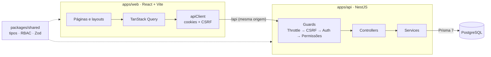

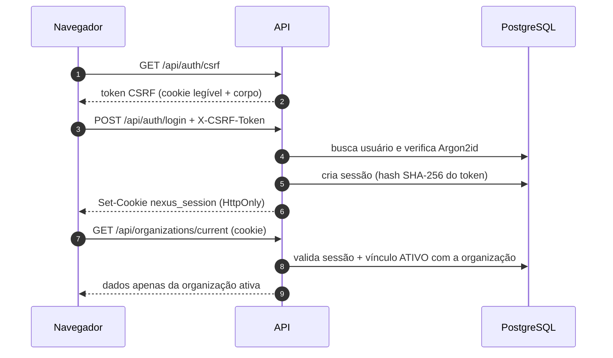

- **Monorepositório** com pnpm workspaces: `apps/web`, `apps/api` e `packages/shared`.
- **API modular** (`auth`, `organizations`, `customers`, `deals`, `mail`, `health`), com regras de
  negócio nos services e controllers finos. Todo acesso a clientes e negócios passa por um filtro
  de escopo (organização ativa + carteira do vendedor).
- **Frontend** separado em `services` (acesso à API), `features` (hooks e componentes por domínio),
  `pages`, `layouts` e `routes`.

Detalhes em [docs/architecture.md](docs/architecture.md) e decisões em
[docs/decisions.md](docs/decisions.md).

<details>
<summary><strong>Estrutura de pastas</strong></summary>

```
nexus-crm/
├── apps/
│   ├── api/                      # NestJS
│   │   ├── prisma/               # schema, migrations e seed de demonstração
│   │   ├── src/
│   │   │   ├── common/           # guards, decorators, filtros, segurança, utilitários
│   │   │   ├── config/           # validação e acesso tipado ao ambiente
│   │   │   ├── modules/          # auth, organizations, customers, deals, mail, health
│   │   │   └── prisma/           # PrismaService
│   │   └── test/                 # testes de integração
│   └── web/                      # React + Vite
│       └── src/
│           ├── app/              # providers e tema
│           ├── components/       # componentes compartilhados e ui/ (shadcn)
│           ├── features/         # auth, customers, deals, dashboard, organization
│           ├── layouts/          # AuthLayout, AppLayout (sidebar, topbar)
│           ├── lib/              # query client, navegação, formatação
│           ├── pages/            # páginas por rota
│           ├── routes/           # router e guards de rota
│           ├── services/         # camada de acesso à API
│           └── types/
├── packages/shared/              # tipos, RBAC e schemas compartilhados
├── docker/                       # scripts de inicialização do Postgres
├── docs/                         # arquitetura, decisões e capturas de tela
└── docker-compose.yml
```

</details>

## 🧪 Testes

| Suíte                   | Ferramentas                   | Testes | Cobertura principal                                                |
| ----------------------- | ----------------------------- | -----: | ------------------------------------------------------------------ |
| `packages/shared`       | Vitest                        |     58 | RBAC, schemas, CPF/CNPJ, telefones, tags, valores em reais e datas |
| `apps/api` (unitários)  | Jest                          |     31 | CSRF, permissões, escopo, login, validação, transições e posições  |
| `apps/api` (integração) | Jest + Supertest + PostgreSQL |     66 | Critérios de aceite das Fases 1 a 3 (abaixo)                       |
| `apps/web`              | Vitest + Testing Library      |     57 | Rotas, login, cliente HTTP, filtros, formulário de negócio, quadro |

Critérios de aceite verificados pelos testes de integração:

- ✅ Um usuário consegue se cadastrar e entrar; os dados são persistidos no PostgreSQL.
- ✅ Usuário não autenticado não acessa rotas protegidas (401).
- ✅ Vendedor não acessa endpoints administrativos (403) e nada é alterado no banco.
- ✅ Usuários de organizações distintas não consultam nem alteram dados uns dos outros.
- ✅ O logout revoga a sessão: o mesmo cookie deixa de funcionar.
- ✅ Vínculo suspenso perde o acesso imediatamente; CSRF, rate limit e redefinição de senha.
- ✅ Vendedor vê e altera apenas a própria carteira; clientes de outros respondem 404.
- ✅ Só a gestão distribui clientes, e apenas para membros ativos da mesma organização.
- ✅ Empresa vinculada, responsável e contatos não podem apontar para outra organização.
- ✅ Busca, filtros, paginação, tags e totais respeitam o escopo de cada perfil.
- ✅ Toda organização nasce com o funil padrão; negócios só usam clientes visíveis ao usuário.
- ✅ Movimentações gravam histórico; perda sem motivo e etapa de outro funil são recusadas.
- ✅ Só gestores e administradores reabrem ou movem negócios encerrados, que não podem ser editados.
- ✅ A ordem dos cards é preservada; o quadro de uma organização nunca mostra negócios de outra.
- ✅ Cliente com negócios não pode ser excluído.

```bash
pnpm test               # unitários (shared, API e web)
pnpm test:integration   # integração da API contra PostgreSQL (usa DATABASE_URL_TEST)
```

Os testes de integração usam um banco separado (`nexus_crm_test`), limpo antes de cada teste. O
[pipeline de CI](.github/workflows/ci.yml) executa lint, formatação, typecheck, testes unitários,
testes de integração com PostgreSQL e build.

## 📜 Scripts

Executados na raiz do repositório:

| Comando                        | Descrição                                                           |
| ------------------------------ | ------------------------------------------------------------------- |
| `pnpm dev`                     | Sobe pacote compartilhado (watch), API e Web                        |
| `pnpm build`                   | Build de produção de todos os pacotes                               |
| `pnpm typecheck`               | Verificação de tipos em todo o monorepositório                      |
| `pnpm lint` / `lint:fix`       | ESLint                                                              |
| `pnpm format` / `format:check` | Prettier                                                            |
| `pnpm test`                    | Testes unitários (shared, API e web)                                |
| `pnpm test:integration`        | Testes de integração da API contra PostgreSQL (`DATABASE_URL_TEST`) |
| `pnpm db:up` / `db:down`       | Sobe/derruba o PostgreSQL no Docker                                 |
| `pnpm db:migrate`              | Cria/aplica migrations em desenvolvimento (`prisma migrate dev`)    |
| `pnpm db:deploy`               | Aplica migrations existentes (`prisma migrate deploy`)              |
| `pnpm db:seed`                 | Popula os dados de demonstração                                     |
| `pnpm db:reset`                | Recria o banco de desenvolvimento do zero                           |

## 🔐 Segurança

- Senhas com **Argon2id** e verificação em tempo constante para e-mails inexistentes.
- **Sessão server-side**: o cookie carrega só um token aleatório de 256 bits; o banco guarda apenas
  o hash SHA-256.
- **CSRF** (_signed double-submit cookie_) em todas as requisições de escrita, mais verificação de
  `Origin`.
- **Rate limiting** geral e restrito nos endpoints de autenticação.
- **Multi-tenant**: rotas operam sobre a organização ativa da sessão; organizações inexistentes e
  alheias recebem a mesma resposta, sem revelar quais existem.
- Validação estrita de DTOs (`whitelist` + `forbidNonWhitelisted`), Helmet, CORS restrito,
  `Cache-Control: no-store`, erros padronizados sem detalhes internos e logs sem corpo, cookies ou
  tokens.
- Segredos apenas em variáveis de ambiente, validadas na inicialização. Arquivos `.env` nunca são
  versionados — cada um tem um `.env.example` documentado.

| Arquivo         | Uso                                                         |
| --------------- | ----------------------------------------------------------- |
| `.env`          | Docker Compose (usuário, senha, banco e porta do Postgres)  |
| `apps/api/.env` | API: banco, segredo CSRF, sessão, rate limit, Swagger, seed |
| `apps/web/.env` | Opcional: destino do proxy e URL da API                     |

## 🗺 Roadmap

| Fase | Escopo                                                                 | Status       |
| ---- | ---------------------------------------------------------------------- | ------------ |
| 1    | Fundação: monorepo, auth, organizações, RBAC, layout, seed, testes, CI | ✅ Concluída |
| 2    | Clientes e contatos: CRUD, busca, filtros, paginação, permissões       | ✅ Concluída |
| 3    | Negociações: pipeline, etapas, Kanban com drag-and-drop, histórico     | ✅ Concluída |
| 4    | Dashboard com indicadores reais, tarefas e atividades                  | ⏳ Próxima   |
| 5    | Administração (convites, permissões, pipelines), relatórios, auditoria | Planejada    |
| 6    | Testes E2E (Playwright), revisão de segurança, deploy e documentação   | Planejada    |

## 👤 Autor

Desenvolvido por [**UyankDouglas**](https://github.com/UyankDouglas) como projeto de portfólio.

Todos os dados de demonstração são fictícios. Este repositório ainda não define uma licença de uso.
